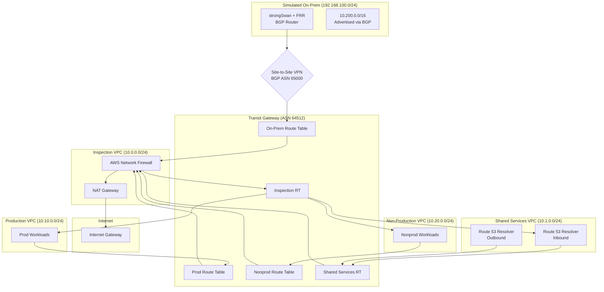

# AWS Hybrid Network Landing Zone

A production-grade Terraform reference architecture for AWS hybrid networking. This project demonstrates advanced networking patterns including Transit Gateway with segmented routing, centralized inspection via AWS Network Firewall, hybrid DNS with Route 53 Resolver, and BGP-based VPN connectivity to a simulated on-premises environment.

Built by [Harinder Singh](https://github.com/harin-singh) - Cloud Infrastructure & SRE Leader with AWS Advanced Networking Specialty, Solutions Architect Professional, and Terraform Associate certifications. Deep experience with Transit Gateway, Direct Connect, BGP routing, Route 53 hybrid DNS, and Zscaler across 40+ AWS accounts.

## Why This Matters

Enterprise AWS deployments need more than VPC peering. They need:

- **Segmentation**: Prod and non-prod workloads isolated at the network layer
- **Centralized inspection**: All east-west and egress traffic through a security appliance
- **Hybrid connectivity**: Reliable, BGP-based routing to on-premises data centers
- **Hybrid DNS**: Seamless name resolution across AWS and corporate networks
- **Scalability**: A hub-and-spoke model that scales to dozens of accounts

This project implements these patterns with production-ready Terraform modules. It pairs well with my [AWS Network MCP](https://github.com/harin-singh/aws-network-mcp) server for AI-assisted network diagnostics.

## Architecture



## Segmentation Rules

All traffic flows through the inspection VPC. Route table associations and propagations enforce segmentation:

| Attachment | Associates With | Propagates To | Can Reach |
|------------|-----------------|---------------|-----------|
| Prod VPC | `prod` RT | `inspection` RT | Shared Services, On-prem, Internet (inspected) |
| Nonprod VPC | `nonprod` RT | `inspection` RT | Shared Services, Internet (inspected) |
| Shared Services VPC | `shared-services` RT | All RTs | All VPCs, On-prem |
| Inspection VPC | `inspection` RT | None | Return traffic to all attachments |
| VPN (On-prem) | `onprem` RT | `prod`, `shared-services`, `inspection` RTs | Prod, Shared Services |

### Traffic Flow Examples

**Prod to Internet:**
```
Prod EC2 → Prod RT (0.0.0.0/0 → Inspection) → TGW → Inspection VPC → 
Network Firewall → NAT Gateway → IGW → Internet
```

**Prod to On-prem:**
```
Prod EC2 → Prod RT (10.200.0.0/16 → Inspection) → TGW → Inspection VPC → 
Network Firewall → TGW → On-prem RT → VPN → On-prem Router
```

**Prod to Nonprod (BLOCKED):**
```
Prod EC2 → Prod RT → No route to 10.20.0.0/24 → DROPPED
```

## Modules

| Module | Purpose |
|--------|---------|
| `transit-gateway` | Hub TGW with segmented route tables (prod, nonprod, shared-services, inspection, onprem) |
| `spoke-vpc` | Workload VPC with TGW attachment subnets, no IGW, optional SSM endpoints |
| `inspection-vpc` | Network Firewall with appliance mode, centralized NAT egress |
| `shared-services-vpc` | Route 53 Resolver inbound/outbound endpoints, forwarding rules, private zones |
| `egress-vpc` | Simple NAT-only egress (alternative to inspection for cost savings) |
| `site-to-site-vpn` | TGW VPN attachment with BGP, configurable IPsec/IKE parameters |
| `simulated-onprem` | EC2 router running strongSwan + FRR for testing hybrid connectivity |

## Design Decisions

### Why Appliance Mode on the Inspection VPC Attachment?

Appliance mode ensures symmetric routing. Without it, return traffic might exit through a different AZ's firewall endpoint than the ingress traffic entered, breaking stateful inspection. This is critical for Network Firewall and any third-party appliances.

### Why Separate Route Tables?

A single default route table would allow all attachments to reach each other. Separate route tables let us control exactly which routes propagate to which attachments. Prod's route table doesn't receive nonprod routes, so there's no path between them at the TGW layer.

### Why BGP for VPN?

Static routing requires manual updates when on-premises networks change. BGP dynamically learns routes and provides automatic failover between tunnels. The 10-second timers in the FRR config ensure fast convergence.

### Why This ASN Scheme?

- **TGW (64512)**: Start of the private 2-byte ASN range, clearly identifies the AWS side
- **On-prem (65000)**: Common choice for customer gateways, leaves room for multiple sites (65001, 65002, etc.)

### DNS Architecture

Route 53 Resolver endpoints enable bidirectional DNS:
- **Inbound**: On-prem DNS servers forward `aws.example.internal` queries to the inbound endpoint IPs
- **Outbound**: Forwarding rules send `corp.example.internal` queries through the outbound endpoint to on-prem DNS servers

Forwarding rules are shared via RAM so spoke VPCs automatically resolve on-prem names.

## Direct Connect Integration

The simulated on-prem environment uses Site-to-Site VPN for demonstration. In production, Direct Connect provides dedicated, consistent bandwidth. The architecture would change to:

```
On-prem Router → Direct Connect Location → DX Connection → 
DX Gateway → Transit VIF → Transit Gateway
```

Key differences:
- **Transit VIF**: A transit virtual interface on the DX gateway associates with the TGW
- **No IPsec overhead**: Direct layer-2 connectivity
- **Predictable latency**: Dedicated fiber vs. internet-based VPN
- **Higher bandwidth**: 1-100 Gbps vs. 1.25 Gbps per VPN tunnel

The TGW route tables and segmentation work identically whether traffic arrives via VPN or DX.

## Multi-Account Pattern

This example runs in a single account for simplicity. For multi-account deployments:

1. **Network Account**: Owns the TGW, inspection VPC, shared services VPC
2. **Workload Accounts**: Own spoke VPCs, attach to shared TGW

```hcl
# In network account - share TGW via RAM
module "transit_gateway" {
  source = "./modules/transit-gateway"
  
  share_tgw = true
  ram_principals = [
    "arn:aws:organizations::111111111111:ou/o-example/ou-example-prod",
    "arn:aws:organizations::111111111111:ou/o-example/ou-example-nonprod",
  ]
}

# In workload account - reference shared TGW
data "aws_ec2_transit_gateway" "shared" {
  filter {
    name   = "owner-id"
    values = ["<network-account-id>"]
  }
}
```

Consider AWS VPC IPAM for centralized CIDR management across accounts:

```hcl
# Enable IPAM allocation in spoke-vpc module
module "spoke_vpc" {
  source = "./modules/spoke-vpc"
  
  ipam_pool_id        = aws_vpc_ipam_pool.prod.id
  ipam_netmask_length = 24
}
```

## Cost Estimate

### Complete Example (~$730/month idle)

| Resource | Hourly | Monthly | Notes |
|----------|--------|---------|-------|
| Transit Gateway | $0.05 | $36.50 | Base cost |
| TGW Attachments (5) | $0.25 | $182.50 | $0.05/attachment-hour |
| TGW Data Processing | - | ~$50 | $0.02/GB |
| Network Firewall | $0.395 | $288.35 | Per endpoint |
| NFW Data Processing | - | ~$30 | $0.065/GB |
| NAT Gateway | $0.045 | $32.85 | Single NAT |
| NAT Data Processing | - | ~$20 | $0.045/GB |
| VPN Connection | $0.05 | $36.50 | 2 tunnels |
| Route 53 Resolver | $0.125 | $91.25 | 4 endpoints |
| EC2 Instances | ~$0.05 | ~$35 | t3.micro/small |

### Minimal Example (~$215/month idle)

No Network Firewall, no VPN, no Resolver endpoints, single AZ.

## Quick Start

```bash
# Clone
git clone https://github.com/harin-singh/aws-hybrid-network-landing-zone.git
cd aws-hybrid-network-landing-zone

# Validate
make validate

# Deploy minimal (cheaper)
cd examples/minimal
terraform init
terraform apply

# Or deploy complete
cd examples/complete
cp terraform.tfvars.example terraform.tfvars
terraform init
terraform apply

# Test connectivity
../scripts/test-connectivity.sh

# IMPORTANT: Destroy when done
terraform destroy
# or from repo root:
make destroy
```

## Testing

### Terraform Tests (No AWS Credentials Required)

```bash
terraform test
```

Uses mock providers to validate module logic without deploying resources.

### Connectivity Matrix (Requires Deployment)

```bash
cd examples/complete
./scripts/test-connectivity.sh
```

Uses SSM Run Command to verify segmentation rules are enforced.

### VPN/BGP Status

```bash
./scripts/check-vpn-status.sh
```

## CI Pipeline

GitHub Actions runs on every PR:

- `terraform fmt -check`: Code formatting
- `terraform validate`: Configuration validity
- `tflint`: Terraform best practices
- `checkov`: Security scanning
- `gitleaks`: Secret detection
- `terraform test`: Mock provider tests
- `terraform-docs`: Documentation generation

## Repository Structure

```
.
├── modules/
│   ├── transit-gateway/      # Hub TGW with segmented route tables
│   ├── spoke-vpc/            # Workload VPCs
│   ├── inspection-vpc/       # Network Firewall + NAT
│   ├── shared-services-vpc/  # Route 53 Resolver
│   ├── egress-vpc/           # Simple NAT egress
│   ├── site-to-site-vpn/     # BGP VPN
│   └── simulated-onprem/     # strongSwan + FRR router
├── examples/
│   ├── complete/             # Full architecture
│   └── minimal/              # Cost-optimized
├── tests/                    # Terraform test files
├── scripts/                  # Connectivity testing
├── docs/                     # Additional documentation
└── .github/workflows/        # CI pipeline
```

## Roadmap

- [ ] AWS Firewall Manager integration
- [ ] Gateway Load Balancer for third-party appliances
- [ ] AWS Network Manager for global network visualization
- [ ] Terraform Cloud workspace configuration
- [ ] Cost optimization recommendations based on flow logs

## Related Projects

- [aws-network-mcp](https://github.com/harin-singh/aws-network-mcp): MCP server for AI-assisted network diagnostics. Deploy this landing zone, then use the MCP server to troubleshoot connectivity issues.

## License

MIT License - see [LICENSE](LICENSE) for details.

---

*This is a clean-room reference implementation for portfolio purposes. No employer-specific configurations, real account IDs, or production IP addresses are included.*
