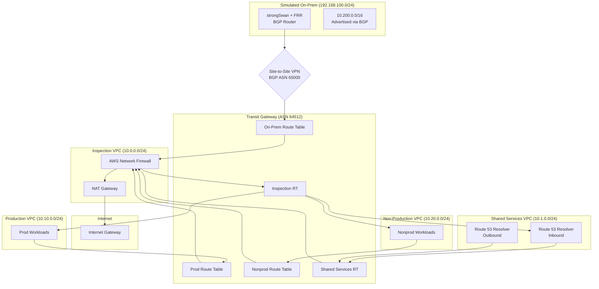

# AWS Hybrid Network Landing Zone

Terraform modules for an AWS hub-and-spoke network: Transit Gateway with separate route tables, centralized inspection (Network Firewall + NAT), hybrid DNS (Route 53 Resolver), and a BGP Site-to-Site VPN to a simulated on-premises router.

Related: [aws-network-mcp](https://github.com/harin-singh/aws-network-mcp) for network diagnostics against a deployed hub.

## Architecture



## Segmentation

East-west and egress traffic is steered to the inspection VPC (`0.0.0.0/0` and specific prefixes on each spoke RT). Denied pairs are dropped twice:

1. **TGW blackhole** – more specific than the default route, so the packet never reaches inspection.
2. **Network Firewall** – `STRICT_ORDER` with `stateful_default_actions = ["aws:drop_established"]` and explicit drop/pass Suricata rules.

| Attachment | Associates With | Propagates To | Can Reach |
|------------|-----------------|---------------|-----------|
| Prod VPC | `prod` RT | `inspection` RT | Shared Services, On-prem, Internet (inspected) |
| Nonprod VPC | `nonprod` RT | `inspection` RT | Shared Services, Internet (inspected) |
| Shared Services VPC | `shared-services` RT | `inspection` RT | All VPCs, On-prem |
| Inspection VPC | `inspection` RT | None | Return traffic to all attachments |
| VPN (On-prem) | `onprem` RT | `inspection` RT | Prod, Shared Services |

VPN and spoke prefixes are **not** propagated onto prod/nonprod/shared RTs. Those tables use static routes via the inspection attachment plus blackholes for denied CIDRs, so BGP cannot install a more-specific path that skips the firewall.

### Traffic Flow Examples

**Prod to Internet:**
```
Prod EC2 → Prod RT (0.0.0.0/0 → Inspection) → TGW → Inspection VPC →
Network Firewall → NAT Gateway → IGW → Internet
```

**Prod to On-prem:**
```
Prod EC2 → Prod RT (10.200.0.0/16 and 192.168.100.0/24 → Inspection) → TGW →
Inspection VPC → Network Firewall → TGW → On-prem RT → VPN → On-prem Router
```

**Prod to Nonprod (BLOCKED at TGW, also dropped by firewall):**
```
Prod EC2 → Prod RT (10.20.0.0/24 blackhole) → DROPPED
```

`scripts/test-connectivity.sh` asserts the same matrix (prod/nonprod/on-prem ping allow/deny).

## Modules

| Module | Purpose |
|--------|---------|
| `transit-gateway` | Hub TGW with segmented route tables and optional RAM share / blackholes |
| `spoke-vpc` | Workload VPC with TGW attachment subnets, no IGW, optional SSM endpoints |
| `inspection-vpc` | Network Firewall (default drop) with appliance mode and centralized NAT |
| `shared-services-vpc` | Route 53 Resolver inbound/outbound endpoints, forwarding rules, private zones |
| `egress-vpc` | NAT-only egress (cheaper alternative to inspection) |
| `site-to-site-vpn` | TGW VPN attachment with BGP |
| `simulated-onprem` | EC2 router (strongSwan + FRR); VPN PSKs live in SSM, not user_data |

## Design Decisions

### Appliance mode on the inspection attachment

Return traffic must egress the same AZ firewall endpoint it entered, or stateful inspection breaks.

### Separate route tables plus blackholes

A single default TGW route table would allow every attachment to reach every other. Separate tables control association and propagation. Blackholes cover the case where a default route to inspection would otherwise forward a denied prefix.

### BGP for VPN

Static VPN routes need manual updates when on-prem prefixes change. BGP learns them and fails over between tunnels. FRR uses 10-second keepalive / 30-second hold.

### ASN scheme

- **TGW (64512)**: start of the private 2-byte range
- **On-prem (65000)**: common customer-gateway choice; 65001+ remains available for more sites

### DNS

- **Inbound resolver**: on-prem forwarders send `aws.example.internal` to the inbound ENI IPs
- **Outbound resolver**: `corp.example.internal` is forwarded to on-prem DNS
- Forwarding rules can be RAM-shared so spoke VPCs resolve on-prem names

## Direct Connect

Direct Connect is **not deployed**. [docs/direct-connect.md](docs/direct-connect.md) is a design note covering DX Gateway + transit VIF as an alternative to the lab VPN. TGW route tables stay the same if a DX attachment replaces the VPN attachment in the `onprem` table.

## Multi-account

[examples/multi-account](examples/multi-account) is a validate-able two-account config: network account owns TGW + inspection and shares the TGW via RAM; a workload account attaches a spoke. Route table association is created by the TGW owner. An Organizations SCP (`policies/protect-network-hub.json`) denies TGW and route-table mutation outside the network account.

The single-account [examples/complete](examples/complete) stack is the lab that `scripts/test-connectivity.sh` exercises.

## Cost Estimate (us-east-1)

Prices below are AWS public list prices for **us-east-1**, idle (no data processing). Month = 730 hours. Check current numbers on the linked pages before budgeting.

Sources: [Transit Gateway](https://aws.amazon.com/transit-gateway/pricing/), [Network Firewall](https://aws.amazon.com/network-firewall/pricing/), [Route 53](https://aws.amazon.com/route53/pricing/), [NAT Gateway](https://aws.amazon.com/vpc/pricing/), [Site-to-Site VPN](https://aws.amazon.com/vpn/pricing/), [EC2 on-demand](https://aws.amazon.com/ec2/pricing/on-demand/), [public IPv4](https://aws.amazon.com/vpc/pricing/).

### Complete example (`az_count = 2`)

| Resource | Math | Hourly | Monthly |
|----------|------|--------|---------|
| TGW attachments (5) | 5 × $0.05 | $0.25 | $182.50 |
| Network Firewall endpoints (2) | 2 × $0.395 | $0.79 | $576.70 |
| NAT Gateway (1) | 1 × $0.045 | $0.045 | $32.85 |
| Site-to-Site VPN | 1 × $0.05 | $0.05 | $36.50 |
| Route 53 Resolver ENIs (4) | inbound+outbound × 2 AZs × $0.125 | $0.50 | $365.00 |
| EC2 | t3.small + 3 × t3.micro ($0.0208 + 3×$0.0104) | $0.052 | $37.96 |
| Public IPv4 (4) | NAT EIP + router EIP + 2 VPN tunnel IPs × $0.005 | $0.02 | $14.60 |
| KMS CMKs (approx. 6) | $1/key-month | — | $6.00 |
| **Idle total** | | **~$1.71** | **~$1,252** |

Notes:

- There is **no** separate TGW hourly fee beyond attachments.
- Resolver is billed **per ENI-hour**, not per endpoint object. Two endpoints in two AZs = four ENIs.
- Network Firewall is billed **per endpoint-hour**. `az_count = 2` provisions two endpoints.
- Data processing (TGW $0.02/GB, NFW $0.065/GB, NAT $0.045/GB, VPN data transfer) is extra and is ~$0 when idle.
- CloudWatch Logs ingestion/storage is extra.

See [docs/DEPLOY_AND_VERIFY.md](docs/DEPLOY_AND_VERIFY.md) for per-hour run cost and teardown.

### Minimal example (1 AZ, no NFW, no VPN, no Resolver)

| Resource | Math | Hourly | Monthly |
|----------|------|--------|---------|
| TGW attachments (4) | 4 × $0.05 | $0.20 | $146.00 |
| NAT Gateway (1) | 1 × $0.045 | $0.045 | $32.85 |
| **Idle total** | | **~$0.25** | **~$179** |

## Quick Start

```bash
git clone https://github.com/harin-singh/aws-hybrid-network-landing-zone.git
cd aws-hybrid-network-landing-zone

make validate

# Cheaper hub (no firewall, no VPN)
cd examples/minimal
terraform init
terraform apply

# Full hub (see cost table)
cd examples/complete
cp terraform.tfvars.example terraform.tfvars
terraform init
terraform apply

# From examples/complete:
../../scripts/test-connectivity.sh

terraform destroy
```

Step-by-step apply, test, evidence capture, and destroy: [docs/DEPLOY_AND_VERIFY.md](docs/DEPLOY_AND_VERIFY.md).

## Testing

### Terraform tests (no AWS credentials)

```bash
terraform test
```

Tests live in `tests/` and assert TGW blackholes, firewall default-drop, denied prod↔nonprod rules, IMDSv2, and that VPN PSKs are not in user_data.

### Connectivity matrix (requires a live complete stack)

```bash
cd examples/complete
../../scripts/test-connectivity.sh
```

Uses SSM Run Command. Exit code 1 on any failed assertion.

### VPN/BGP status

```bash
./scripts/check-vpn-status.sh
```

## Local development

Install [pre-commit](https://pre-commit.com/) and the tools below, then install the git hooks:

```bash
pip install pre-commit
make setup          # pre-commit install --install-hooks
```

Run every hook on the whole repository (same command as CI):

```bash
make pre-commit     # pre-commit run --all-files
```

Required versions (same as CI):

| Tool | Version | Notes |
|------|---------|--------|
| Terraform | 1.9.8 | `terraform_fmt`, `terraform_validate` |
| TFLint | v0.53.0 | uses [`.tflint.hcl`](.tflint.hcl) |
| Checkov | 3.4.3 | uses [`.checkov.yaml`](.checkov.yaml); installed by the pinned hook |
| Gitleaks | v8.30.1 | uses [`.gitleaks.toml`](.gitleaks.toml); installed by the pinned hook |
| pre-commit | 3.2+ | Python 3.12 |

Do not set `SKIP` or `--from-ref` when reproducing CI.

## CI

GitHub Actions on every PR:

- `terraform fmt -check`
- `terraform validate` on every module and example (including `examples/multi-account`)
- `tflint` (fails the job on findings)
- `checkov` (`.checkov.yaml` only; no `continue-on-error` / `|| true`)
- `gitleaks`
- `terraform test`
- `pre-commit run --all-files` (same config/skip lists as the jobs above)

## Repository Structure

```
.
├── modules/
│   ├── transit-gateway/
│   ├── spoke-vpc/
│   ├── inspection-vpc/
│   ├── shared-services-vpc/
│   ├── egress-vpc/
│   ├── site-to-site-vpn/
│   └── simulated-onprem/
├── examples/
│   ├── complete/
│   ├── minimal/
│   └── multi-account/
├── tests/
├── scripts/
├── docs/
│   ├── DEPLOY_AND_VERIFY.md
│   ├── direct-connect.md      # design only, not deployed
│   ├── multi-account.md
│   └── evidence/              # populate after a real apply; not fabricated
└── .github/workflows/
```

## License

MIT License - see [LICENSE](LICENSE).
